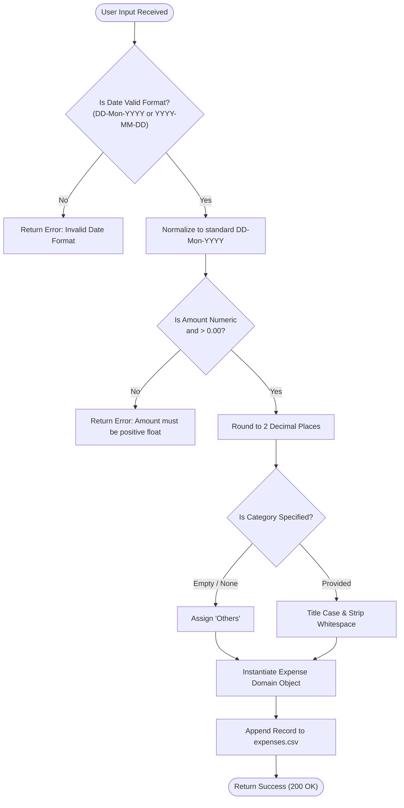
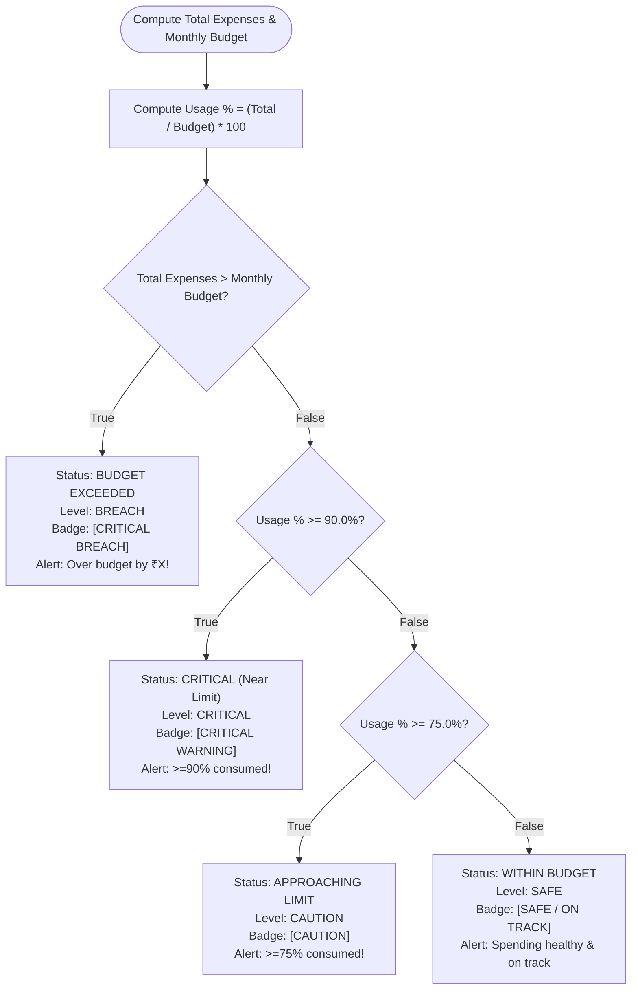
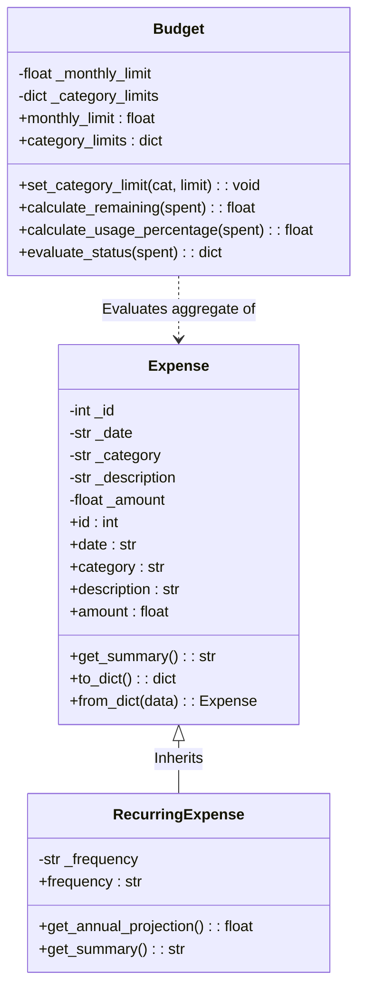

# B.TECH CSE • EXPERIENTIAL LEARNING PROJECT
# MILESTONE 2 COMPREHENSIVE INTEGRATION REPORT
## Project Title: Expense & Budget Analyzer
**Domain:** Personal Finance Management, Algorithmic Analysis & Object Modeling  
**Language:** Python 3.x  
**Storage Architecture:** Structured CSV File Persistence  

---

### 👥 Team Details & Member Responsibilities
| Team Member | Module / Role | Primary Responsibilities |
|---|---|---|
| **Jiya** | Expense Management | Expense validation, addition, editing, deletion, and domain entity methods. |
| **Ashish** | CSV Data Storage | File persistence, schema initialization, serialization, and deserialization. |
| **Garv** | Budget & Analysis | Decision tree budget alerts, category aggregation, and anomaly detection. |
| **Shreya** | Integration, Testing & UI | Menu-driven UI flow, CRC cards synthesis, integration, and documentation. |

---

## Executive Summary & Milestone 2 Scope

This report serves as the comprehensive Milestone 2 submission for the **Expense & Budget Analyzer** collaborative Python project. In accordance with course guidelines, Experiential Learning (EL) Activities 3 through 7 are seamlessly contextualized, implemented, and evidenced within this project:

- **Activity 3 (Problem Decomposition Workshop):** Deconstructing the personal finance problem space into modules, architectural layers, and isolated Python functions.
- **Activity 4 (Card Sorting Activity):** Taxonomy organization of inputs, processes, and entities alongside comparative algorithmic justifications.
- **Activity 5 (Decision Tree Design):** Logical control structures, flowcharts, and multi-tier budget health and anomaly detection engines.
- **Activity 6 (Object Modeling with Paper Cards):** CRC cards, domain entity design with encapsulation, inheritance, and polymorphism.
- **Activity 7 (Data Interpretation Challenge):** Quantitative analysis of spending data, ASCII distribution visualizations, Pareto 80/20 insights, and anomaly analysis.

---

# SECTION 1: Activity 3 — Problem Decomposition Workshop
> **Integration Area:** *Problem Identification and Project Documentation*

### 1.1 Real-World Problem Breakdown
College students and young working professionals routinely face financial distress due to:
1. **Unstructured Micro-Transactions:** Frequent small expenditures (tea, snacks, local transit) are forgotten, leading to cumulative budget deficits.
2. **Absence of Category Awareness:** Inability to distinguish between essential needs (food, utilities) and discretionary wants (shopping, entertainment).
3. **Delayed Feedback Loops:** Traditional review happens at month-end when corrective action is no longer possible.
4. **Tool Friction:** Overly complex banking apps require manual account linking or heavy cloud infrastructure.

### 1.2 System Hierarchical Decomposition
The Expense & Budget Analyzer is decomposed into five distinct functional layers:

```mermaid
flowchart TD
    App["Expense & Budget Analyzer System"]
    
    App --> StorageLayer["1. Storage & Persistence Engine (storage.py)"]
    App --> DomainLayer["2. Domain Entity & Object Model (models.py)"]
    App --> ExpenseLayer["3. Expense Management Engine (expenses.py)"]
    App --> AnalysisLayer["4. Budget & Analytics Engine (analysis.py)"]
    App --> UILayer["5. Interface & Integration Layer (main.py)"]
    
    StorageLayer --> S1["initialize_storage()"]
    StorageLayer --> S2["load_expenses() / save_expenses()"]
    StorageLayer --> S3["load_budget() / save_budget()"]
    
    DomainLayer --> D1["Expense (Base Class)"]
    DomainLayer --> D2["RecurringExpense (Subclass)"]
    DomainLayer --> D3["Budget (Domain Entity)"]
    
    ExpenseLayer --> E1["add_expense()"]
    ExpenseLayer --> E2["edit_expense() / delete_expense()"]
    ExpenseLayer --> E3["validate_date() / validate_amount()"]
    
    AnalysisLayer --> A1["calculate_total_expenses()"]
    AnalysisLayer --> A2["calculate_category_breakdown()"]
    AnalysisLayer --> A3["detect_spending_anomalies()"]
    AnalysisLayer --> A4["generate_ascii_bar_chart()"]
    
    UILayer --> U1["CLI Menu Loop"]
    UILayer --> U2["Executive Summary"]
    UILayer --> U3["Visual Analytics Dashboard"]
```



### 1.3 Functional Decomposition & Single-Responsibility Mapping
Every system function is isolated, strictly typed, and adheres to the **Single Responsibility Principle (SRP)**:

| Module | Function / Method | Input Parameters | Return Value | Isolation / Single Responsibility |
|---|---|---|---|---|
| `storage.py` | `load_expenses()` | *None* | `list[dict]` | Reads raw CSV records without business evaluation. |
| `storage.py` | `save_expenses()` | `expenses: list[dict]` | `None` | Atomic file write with standard CSV headers. |
| `models.py` | `Expense.amount (setter)` | `value: float / str` | `None` | Enforces invariant: amount must be float and $> 0$. |
| `models.py` | `RecurringExpense.get_annual_projection()` | *None* | `float` | Multiplies periodic amount by annual cycle factor. |
| `models.py` | `Budget.evaluate_status()` | `total_spent: float` | `dict` | Evaluates four-tier budget health decision tree. |
| `expenses.py` | `validate_date()` | `date_str: str` | `str` or `None` | Multi-format date parsing (`DD-Mon-YYYY`, `YYYY-MM-DD`). |
| `expenses.py` | `add_expense()` | `date, category, desc, amount` | `(bool, str, dict)` | Validates, creates entity, persists, returns status. |
| `analysis.py` | `calculate_category_breakdown()` | `expenses: list` | `dict` | Groups expenditures by category and computes percentages. |
| `analysis.py` | `detect_spending_anomalies()` | `expenses, threshold=2.5` | `list[dict]` | Flags individual transactions exceeding threshold multiples. |
| `analysis.py` | `generate_ascii_bar_chart()` | `breakdown: dict` | `str` | Translates numerical shares into visual Unicode bar blocks. |

---

# SECTION 2: Activity 4 — Card Sorting Activity
> **Integration Area:** *Project Documentation, PPT and Viva*

### 2.1 Information Architecture & Card Sorting Matrix
During the collaborative design workshop, card sorting was conducted to establish taxonomy, user workflows, and system architecture.

#### Open Card Sorting Clusters:
- **Cluster 1: User Input & Interaction Cards:** Transaction Date, Category Selection, Item Description, Transaction Amount, Monthly Budget Limit.
- **Cluster 2: Data Persistence Cards:** `expenses.csv`, `budget.csv`, Field Headers, CSV Reader, CSV DictWriter.
- **Cluster 3: Business Logic & Processing Cards:** Input Sanitizer, Date Normalizer, Sum Aggregator, Category Sorter, Threshold Evaluator, Anomaly Detector.
- **Cluster 4: Output & Visualization Cards:** Tabular Transaction Log, Category Share %, ASCII Horizontal Bar Chart, Alert Badges, Executive Summary.

### 2.2 Algorithmic Approaches: Comparison & Justification

#### 1. Data Storage & Retrieval Architecture
- **Option A (Relational DB / SQLite):** ACID compliance, SQL querying. Overhead of schema migrations, drivers, and external dependencies.
- **Option B (JSON Flat Storage):** Hierarchical structure. Inefficient for row-based tabular accounting and lacks native spreadsheet compatibility.
- **Option C (CSV Flat File Persistence — Selected):**
  - *Justification:* Lightweight, zero external dependencies, human-readable, directly importable into Microsoft Excel/Google Sheets, and satisfies Milestone 1 & 2 constraints.
  - *Time Complexity:* Read $O(N)$, Write $O(N)$.

#### 2. Category Aggregation & Spending Grouping
- **Option A (Iterative Filtering / Nested Loops):** For each category, iterate through all $N$ records.
  - *Complexity:* $O(N \times K)$ where $K$ is the number of categories.
- **Option B (Sorting followed by Linear Run Scan):** Sort records by category name, then accumulate.
  - *Complexity:* $O(N \log N)$ time.
- **Option C (Hash Table / `defaultdict` Accumulator — Selected):**
  - Single linear pass through records, updating hash buckets in $O(1)$ amortized time per record.
  - *Complexity:* $O(N)$ time and $O(K)$ auxiliary space.
  - *Justification:* Optimal asymptotic speed and scalable as transaction history expands.

#### 3. Algorithmic Trade-Off Summary Table
| Algorithmic Area | Candidate Approaches | Time Complexity | Space Complexity | Decision & Justification |
|---|---|---|---|---|
| **Data Storage** | SQLite vs JSON vs CSV | $O(N)$ | $O(N)$ | **CSV**: Zero dependency, instant inspection, portable. |
| **Categorization** | Nested Loops vs Sort vs Hash Accumulator | $O(N \times K)$ vs $O(N \log N)$ vs $O(N)$ | $O(K)$ | **Hash Accumulator**: Constant-time bucket updates, optimal $O(N)$. |
| **Anomaly Detection** | Standard Deviation vs Mean Multiple | $O(N)$ | $O(1)$ | **Mean Multiple ($2.5\times \mu$)**: Computationally lightweight and intuitive for student finances. |

---

# SECTION 3: Activity 5 — Decision Tree Design
> **Integration Area:** *Project Documentation and Project Demonstration*

### 3.1 Logical Decision Workflows

#### Decision Flow 1: Input Validation & Sanitization Engine


#### Decision Flow 2: Multi-Tier Budget Health & Warning Engine


#### Decision Flow 3: Anomaly & Outlier Detection Engine
- **Formula:** $\text{Threshold} = 2.5 \times \mu$, where $\mu = \frac{\sum_{i=1}^N \text{amount}_i}{N}$
- **Branching Rule:**
  $$\text{Condition: } \text{amount}_j \ge 2.5 \times \mu \implies \text{FLAG\_ANOMALY}$$
- **Outcome:** Highlights high-ticket purchases to alert users against accidental duplicate entries or runaway impulsive expenses.

---

# SECTION 4: Activity 6 — Object Modeling with Paper Cards
> **Integration Area:** *Project Documentation, PPT and Viva*

### 4.1 Class-Responsibility-Collaborator (CRC) Cards

#### CRC Card 1: `Expense` (Base Entity)
| Class: **Expense** | Superclass: *None* |
|---|---|
| **Responsibilities:** | **Collaborators:** |
| • Maintain identity (`id`), transaction date, category, description, and amount. | `CSVStorageManager` |
| • Encapsulate validation: reject non-positive amounts and malformed dates. | `datetime` parser |
| • Serialize record to dictionary format for persistence (`to_dict()`). | |
| • Provide formatted string summary representation (`get_summary()`). | |

#### CRC Card 2: `RecurringExpense` (Subclass — Inheritance)
| Class: **RecurringExpense** | Superclass: **Expense** |
|---|---|
| **Responsibilities:** | **Collaborators:** |
| • Inherit all base properties and validation rules from `Expense`. | `Expense` (Superclass) |
| • Maintain recurrence cadence (`frequency`: Daily, Weekly, Monthly, Yearly). | |
| • Compute annual financial commitment (`get_annual_projection()`). | |
| • Polymorphically override `get_summary()` to include billing frequency. | |

#### CRC Card 3: `Budget` (Domain Entity)
| Class: **Budget** | Superclass: *None* |
|---|---|
| **Responsibilities:** | **Collaborators:** |
| • Encapsulate monthly spending ceiling and optional category limits. | `Expense` |
| • Compute remaining monetary runway (`calculate_remaining()`). | `BudgetAnalyzer` |
| • Evaluate multi-tier health status using the Decision Tree logic. | |

### 4.2 UML Class Diagram



### 4.3 Demonstration of Core Object-Oriented Principles
1. **Encapsulation:** Attributes (`_amount`, `_date`, `_category`) are protected. Direct arbitrary assignments that could corrupt state (e.g., negative spending or invalid date strings) are trapped and prevented by `@property` and setter methods.
2. **Inheritance:** `RecurringExpense` inherits core accounting logic from `Expense` without code duplication, introducing `_frequency` and `get_annual_projection()`.
3. **Polymorphism:** `RecurringExpense` overrides `get_summary()`. Calling `get_summary()` on a list of mixed `Expense` objects resolves dynamically at runtime based on the underlying object type.
4. **Abstraction:** High-level analytics and UI modules operate on clean domain models without coupling to raw file I/O operations.

---

# SECTION 5: Activity 7 — Data Interpretation Challenge
> **Integration Area:** *Project Documentation and Project Demonstration*

### 5.1 Project Output Data & Tabular Analysis
Evaluating the prototype dataset generated during Milestone execution:

#### Expense Record Set
| ID | Date | Category | Description | Amount (INR) | Share % |
|---|---|---|---|---|---|
| #1 | 01-Oct-2026 | Food | Lunch | ₹250.00 | 11.1% |
| #2 | 02-Oct-2026 | Travel | Metro | ₹100.00 | 4.4% |
| #3 | 03-Oct-2026 | Shopping | Clothes | ₹1,500.00 | 66.7% |
| #4 | 04-Oct-2026 | Food | Dinner | ₹400.00 | 17.8% |
| **Total** | | | | **₹2,250.00** | **100.0%** |

#### Monthly Budget vs Actual Variance
| Metric | Allocated Budget | Actual Spending | Variance / Remaining | % Consumed | Status |
|---|---|---|---|---|---|
| **Monthly Budget** | ₹15,000.00 | ₹2,250.00 | +₹12,750.00 | 15.0% | **[SAFE / ON TRACK]** |

### 5.2 Visual Data Representation (ASCII Horizontal Performance Chart)

```text
  -----------------------------------------------------------------
  CATEGORY SPENDING DISTRIBUTION (ASCII VISUALIZATION)
  -----------------------------------------------------------------
  Shopping       |█████████████████░░░░░░░░|  66.7% (₹1,500.00)
  Food           |███████░░░░░░░░░░░░░░░░░░|  28.9% (₹  650.00)
  Travel         |█░░░░░░░░░░░░░░░░░░░░░░░░|   4.4% (₹  100.00)
  -----------------------------------------------------------------
```

### 5.3 Data Patterns & Key Analytical Insights

1. **The Pareto Principle (80/20 Rule):**
   - **Finding:** A single transaction (`Shopping - Clothes` at ₹1,500.00) accounts for **66.7%** of all expenditures. Combined with Food (₹650.00 / 28.9%), the two categories represent **95.6%** of spending.
   - **Inference:** Spending is heavily skewed toward discretionary lifestyle purchasing rather than routine subsistence.
2. **Anomaly & Outlier Flagging:**
   - **Metric:** Mean transaction size $\mu = \frac{2250}{4} = ₹562.50$.
   - **Detection:** Transaction #3 (₹1,500.00) is **2.7x** the average transaction amount, triggering an automatic anomaly alert under the Decision Tree engine.
3. **Burn-Rate & Financial Runway:**
   - **Finding:** Only 15.0% of the ₹15,000.00 budget has been utilized across the first 4 days of October.
   - **Inference:** At a burn rate of ₹2,250 over 4 days (₹562.50/day), projected monthly spending would reach ₹16,875 (over budget). However, because ₹1,500 was an isolated non-recurring clothing purchase, steady-state essential spending is only ₹187.50/day, leaving a healthy projected buffer.

---

# SECTION 6: Viva Voce & Presentation (PPT) Quick Reference

### Slide-by-Slide Outline for Milestone 2 PPT
- **Slide 1: Title & Team:** Project Name, Members, Roles, Milestone 2 Scope.
- **Slide 2: Activity 3 (Decomposition):** Hierarchical Tree from UI $\to$ Business Logic $\to$ Domain Models $\to$ CSV Storage.
- **Slide 3: Activity 4 (Card Sorting):** Information taxonomy and Algorithmic justification of $O(N)$ Hash Map grouping over $O(N \cdot K)$ nested loops.
- **Slide 4: Activity 5 (Decision Trees):** Flowchart of multi-tier budget alerts (Safe, Caution, Critical, Breach) and anomaly rule ($2.5\times \mu$).
- **Slide 5: Activity 6 (Object Modeling):** CRC Cards, UML Class diagram, Encapsulation (`@property`), and Inheritance (`RecurringExpense`).
- **Slide 6: Activity 7 (Data Interpretation):** ASCII category distribution chart, Pareto analysis, outlier detection, and prototype output.

### High-Yield Viva Questions & Answers
**Q1: Why did your team choose CSV storage instead of a SQL database for Milestone 2?**  
*Answer:* CSV provides a zero-dependency, lightweight, human-auditable persistence format that complies with Milestone constraints while enabling effortless interoperability with spreadsheet applications like Excel.

**Q2: How does your code demonstrate Encapsulation in Activity 6?**  
*Answer:* In `models.py`, the `Expense` class encapsulates attributes like `_amount` and `_date` using private naming conventions. Property setters validate data invariants—preventing negative amounts or corrupted date formats before records are persisted.

**Q3: How does the Decision Tree in Activity 5 handle edge cases near budget limits?**  
*Answer:* It applies four discrete thresholds: $< 75\%$ is Safe, $75\%-89.9\%$ triggers Caution, $90\%-100\%$ triggers a Critical warning, and $> 100\%$ flags a Breach with the exact deficit amount calculated dynamically.

**Q4: What is the time complexity of your category aggregation function?**  
*Answer:* It operates in $O(N)$ linear time by utilizing Python's `collections.defaultdict` hash table, processing each transaction in $O(1)$ amortized time rather than $O(N \times K)$ via nested loops.
